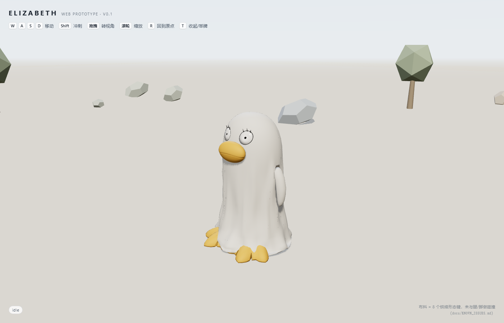
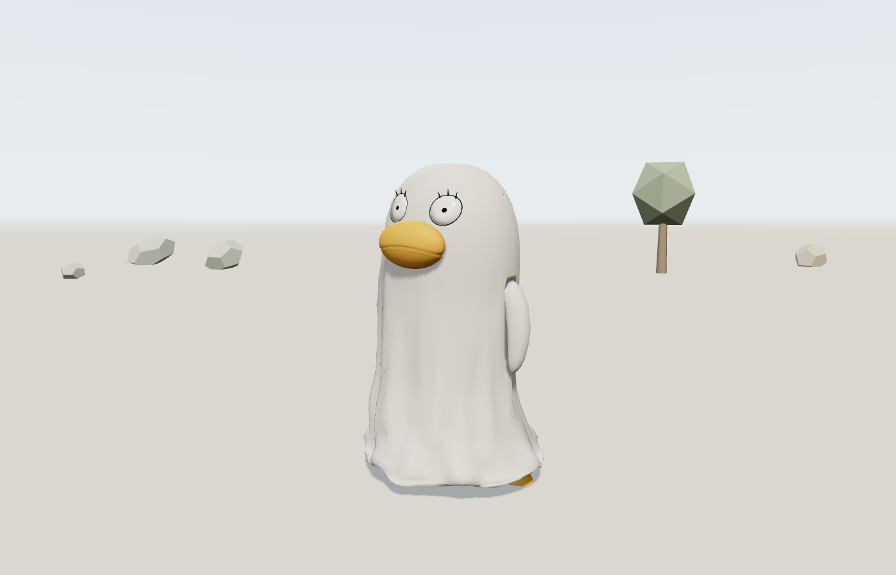

# eliz_game

以《银魂》伊丽莎白为核心的 3D 角色项目。

> **当前阶段：v5.1 长外套（Cloth 烘焙 + 光滑棉布 + 拖地下摆）**（17 网格 / 31,074 tris / 32 骨骼 / 8 morph / idle + run / GLB 1.57 MB）。
> **网页原型 v0.1**：`web/`，Three.js 零构建，WASD 移动 + 跟随相机 + idle/run 交叉淡入（`node web/server.mjs` → http://127.0.0.1:5173/）。
> 平台：Windows 11 x64，仓库 `D:\work\eliz_game`；Blender 4.5.15 LTS 便携版在 `D:\tools\blender-4.5.15-windows-x64\`。
> 产物：`art\blender\eliz_costume_v5.blend`、`art\exports\eliz_costume_v5.glb`（1.57 MB，8 个形态键、无贴图）、`art\renders\v5_*`（四视图 / 褶皱近景 / 3 个跑动 GIF/MP4）。

## 项目概念

这不是"一只实心白鸭子"，而是**玩偶服版**伊丽莎白：

```text
外层：白色长蛋形连体玩偶服（壳 + 双袖，一张网格）
中层：深色内衬 + 底口
内层：毛腿大叔的腿 + 腰胯
配件：黄色鸭蹼鞋、空白牌子
```

核心表演：

- **待机**：壳垂到鞋面，只看到白壳和鸭蹼鞋，看不到毛腿。
- **奔跑**：壳上弹约 0.265m，露出约 0.18m 的毛腿。
- **大动作/彩蛋**：壳再抬高可露出膝盖，但暂不做完整大叔脸。

## 当前文档

- [角色规格书 v1](docs/character_spec.md) —— 尺寸、分件、材质、绑定、动画、验收标准、v1 产出记录。
- [v2 优化规格书](docs/character_spec_v2.md) —— v2 改造（§15）→ v4 软壳（§18）→ **v5 真布褶皱 + 光滑外套（§19）**。
- [会话交接文档](docs/HANDOFF.md) —— 项目背景、讨论结论、当前进度与已知限制。
- [已知问题清单](docs/KNOWN_ISSUES.md) —— **KI-01：布料从未与腿/脚碰撞**（跑动时鞋会穿出后摆，最深 19 cm）；2026-11-10 试过零穿透方案（0 穿透，但下摆撕裂），未采用。

## 目录结构

```text
eliz_game/
  docs/
    character_spec.md
    character_spec_v2.md
    HANDOFF.md
    KNOWN_ISSUES.md    # 已确认但挂起的问题（KI-01 布料碰撞）
  art/
    refs/          # 参考图（版权说明见 art/refs/README.md）
    blender/       # eliz_costume_v5.blend（当前）/ v2.blend（v4.1 对照）
    exports/       # eliz_costume_v5.glb（当前）/ v2.glb（v4.1 对照）
    renders/       # v5_*：四视图 / 褶皱近景 / 跑动 GIF；v2_* / v4_*：历史对照
    textures/      # fabric_albedo / rough / normal（v2 绒面，v5 不再使用）
  web/             # 网页原型（零构建）
    index.html
    server.mjs     # node server.mjs → 5173
    src/           # main / character / cameraRig / input / world
    vendor/        # 本地 three r187（importmap 指向这里）
    assets/eliz.glb
  scripts/
    build_eliz_v5.py        # v5：建模 + 布料烘焙 + 光滑材质 + 渲染 + 导出
    cloth_v5.py             # 单层 proxy + Cloth 烘焙 + 褶皱场 + 形态键 + NLA
    cloth_v5_collide.py     # KI-01 零穿透实验（未接入构建）
    render_v5_views.py      # 只重渲 v5_* 图与跑动帧
    check_v5.py             # v5 验收（8 键 / 褶皱 / 材质 / GLB / NLA）
    probe_leg_clip_v5.py    # 腿/毛/鞋穿透（含形态键；会如实报 KI-01）
    diag_cloth_collision.py # 碰撞体清单 + 每帧鞋/腿穿出量（KI-01 的证据脚本）
    build_eliz_v2.py        # v4.1 基线（保留）
    make_fabric_textures.py # 生成 v2 绒面贴图（v5 不用）
    render_v2_views.py      # 只重渲 v2_* 图
    verify_export_v2.py     # 重导入 v2 GLB 并校验
    check_asset_v2.py       # v4.1 验收检查
    compare_ref.py          # 与参考图的剪影 IoU / 逐行宽度
  tools/           # 临时脚本与裁剪图（不入库）
```

## v5 产出

| 文件 | 说明 |
|---|---|
| [eliz_costume_v5.blend](art/blender/eliz_costume_v5.blend) | 场景 + 32 骨骼 + 8 个形态键 + 布料模拟缓存 + 渲染相机灯光 |
| [eliz_costume_v5.glb](art/exports/eliz_costume_v5.glb) | 17 网格 + 32 骨 + 8 morph + `idle` / `run`（各 97 通道，含 weights）；1.57 MB |
| [v5_front.png](art/renders/v5_front.png) · [v5_side.png](art/renders/v5_side.png) · [v5_back.png](art/renders/v5_back.png) · [v5_three_quarter.png](art/renders/v5_three_quarter.png) | 四视图（光滑外套 + 拖地下摆；跑动只露鸭蹼鞋） |
| [v5_detail_folds.png](art/renders/v5_detail_folds.png) | 长下摆 / 褶皱 / 鞋尖近景 |
| [v5_run.gif](art/renders/v5_run.gif) · [v5_run.mp4](art/renders/v5_run.mp4) | 跑动 24 帧（3/4） |
| [v5_run_side.gif](art/renders/v5_run_side.gif) · [v5_run_side.mp4](art/renders/v5_run_side.mp4) | 跑动 24 帧（侧面） |
| [v5_compare_side.png](art/renders/v5_compare_side.png) | v4.1（短摆、卷边、绒面）vs v5.1（拖地长摆、无卷边、光滑）同帧侧面对比 |

## 网页 demo（v0.1）

零构建的 Three.js 原型：加载 `web/assets/eliz.glb`，WASD 移动、Shift 冲刺、拖拽/滚轮看视角。

```powershell
cd web
node server.mjs        # http://127.0.0.1:5173/
```

| 操作 | 行为 |
|---|---|
| `W A S D` | 相机相对移动；方向在按下瞬间锁定，之后相机跟随不会再改变行进方向 |
| `Shift` | 冲刺（run 动画 `timeScale` 随速度缩放，减少脚滑） |
| 拖拽 / 滚轮 | 环绕视角 / 缩放（2.2–11 m） |
| `R` / `T` | 回到原点 / 收起或举起牌子 |




- 结构：`index.html` + `src/{main,character,cameraRig,input,world}.js` + `vendor/`（本地 three r187）+ `assets/eliz.glb`。
- **没有构建步骤**：three 用 importmap 指到 `vendor/`；部署时把整个 `web/` 丢到任意静态托管即可（无 CDN 依赖）。
- `run` 这一条 clip 同时带骨骼与 8 个 morph 权重通道，所以布料褶皱会跟动画一起播。
- 调试参数：`?clip=run&t=0.3` 冻结姿势、`?yaw=&pitch=&dist=` 定相机、`?hud=0` 隐藏 HUD、`?selftest=240` 跑确定性移动自测（结果写进 `document.title`）。
- 美术缺口：glTF 不导出 Freestyle 墨线，当前是纯 3D 着色；描边留到 M2。
- 已知：后摆穿鞋（KI-01），见 [KNOWN_ISSUES.md](docs/KNOWN_ISSUES.md)。

## v2 产出

| 文件 | 说明 |
|---|---|
| [eliz_costume_v2.blend](art/blender/eliz_costume_v2.blend) | v4.1 基线场景（32 骨、无 morph；v2 造型 + v3 拖地摆 + v4.1 软壳） |
| [eliz_costume_v2.glb](art/exports/eliz_costume_v2.glb) | 17 网格 + 32 骨 + `idle` / `run` + 3 张绒面贴图（v4.1） |
| [v2_front.png](art/renders/v2_front.png) · [v2_side.png](art/renders/v2_side.png) · [v2_back.png](art/renders/v2_back.png) · [v2_three_quarter.png](art/renders/v2_three_quarter.png) | 四视图（正交） |
| [v2_run_reveal.png](art/renders/v2_run_reveal.png) | 壳抬起、露出毛腿 |
| [v2_sign_pose.png](art/renders/v2_sign_pose.png) | 牌子 / 袖口姿态检查 |
| [v2_front_match.png](art/renders/v2_front_match.png) | 与参考图同构图（600×885、黑底）的正面图 |
| [v2_detail_hem.png](art/renders/v2_detail_hem.png) · [v2_detail_armhole.png](art/renders/v2_detail_armhole.png) · [v2_detail_mouth.png](art/renders/v2_detail_mouth.png) · [v2_detail_fabric.png](art/renders/v2_detail_fabric.png) | 近景：下摆 / 袖窿 / 嘴 / 绒面 |
| [v2_wearer_cutaway.png](art/renders/v2_wearer_cutaway.png) | 剖面：外套里隐藏的"服内人"（验证服比人大） |

## 复现

```powershell
Set-Location D:\work\eliz_game
$B = "D:\tools\blender-4.5.15-windows-x64\blender.exe"

# v5：建模 + 布料模拟/烘焙 + 光滑材质 + 渲染 + 导出（约 5–8 分钟）
& $B --background --factory-startup --python-exit-code 1 --python "scripts\build_eliz_v5.py"

# v5 验收：8 个形态键 / 褶皱幅度 / 光滑材质 / NLA / GLB morph 动画
& $B --background --factory-startup --python-exit-code 1 --python "scripts\check_v5.py"

# 腿/毛/鞋穿透（含形态键）。探针已修正：会检查鞋、覆盖全部高度。
# 当前 v5.1 如实报 284 个穿透顶点 / 最深 190 mm（KI-01），修好前该命令返回失败
& $B --background --factory-startup --python-exit-code 1 --python "scripts\probe_leg_clip_v5.py"

# 只重渲 v5 四视图 / 褶皱近景 / 跑动帧（不重跑模拟）
& $B --background --factory-startup --python-exit-code 1 --python "scripts\render_v5_views.py"

# v4.1 基线（保留）
& $B --background --factory-startup --python-exit-code 1 --python "scripts\build_eliz_v2.py"
& $B --background --factory-startup --python-exit-code 1 --python "scripts\verify_export_v2.py"
& $B --background --factory-startup --python-exit-code 1 --python "scripts\check_asset_v2.py"
python scripts\compare_ref.py
```

跑动 GIF/MP4 由 `tools/v5_run_frames/` 的 PNG 用 ffmpeg 编码（命令见 `docs/character_spec_v2.md` §19.4）。

## 下一步

1. 打开 `http://127.0.0.1:5173/` 玩一下：重点看**脚滑**（移动速度与步幅是否匹配）和**后摆穿鞋**（KI-01）在游戏镜头距离下是否明显。
2. 观感 OK 就做 M2：墨线描边 + 灯光/阴影微调；再补一小块地图与碰撞边界（M3）。
3. 若穿模不能接受：先走 [KNOWN_ISSUES.md](docs/KNOWN_ISSUES.md) 的 **A**（把后腿 shin 摆幅 40°→22°，不用重烘布料，只重导出）。
   B（逐顶点顶出到 0 穿透）已试验过：能到 0，但双壁下摆会被撕开，不建议直接用。
4. 要加 `walk` / `jump` / 转身时，8 键烘焙方案不通用，需要每 clip 重烘或改用运行时布料（**C**）。

## 参考图

4 张参考图已放在 [`art/refs/`](art/refs/)，包括正面全身、动画截图、撑伞行走、举牌半身。

这些图片仅用于本项目内部的视觉参考，版权归原作者/版权方所有；**不要在公开仓库中再分发，也不要用于商业用途**。如果仓库是公开的，建议删除图片或只保留原始来源链接。详见 [`art/refs/README.md`](art/refs/README.md)。

## 版权说明

伊丽莎白是空知英秋/集英社《银魂》的角色。本项目用于个人学习、同人原型和非商业开发；商业化发行需要版权授权。
