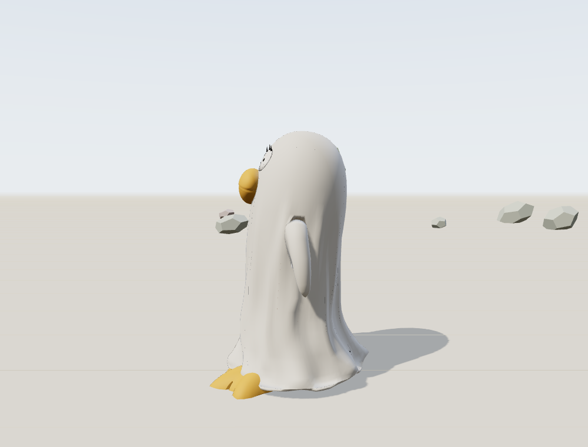
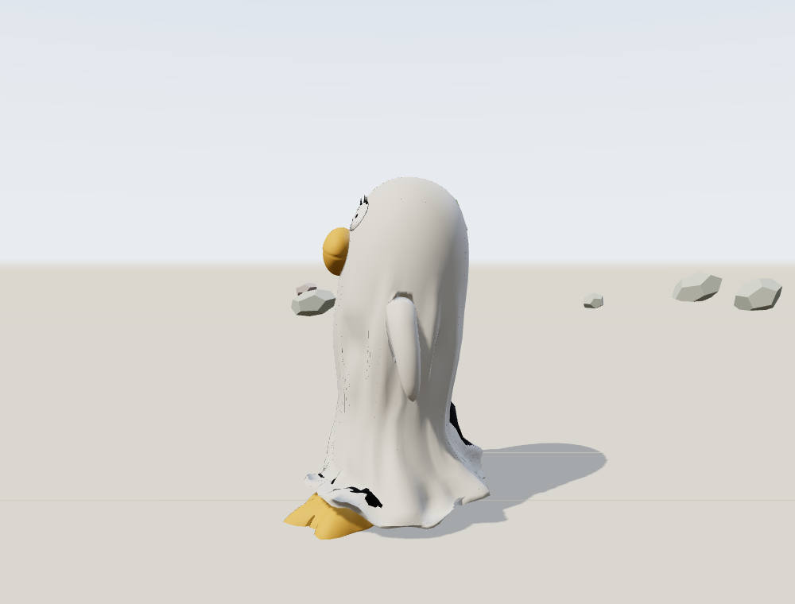

# 已知问题（Known Issues）

> 记录时间：2026-11-10 · 适用资产：v5.1（`art/exports/eliz_costume_v5.glb`）· 网页原型：`web/`
>
> 这里的条目是**已经确认、但按计划挂起**的问题，不是待办猜测。每条都要有：现象、证据、根因、影响、复现方式、修复方向、回看触发条件。

---

## KI-01 布料从未与腿/脚发生碰撞（跑动时鞋会穿出后摆）

**状态**：未修（线上资产 v5.1）。2026-11-10 用 B 方案做了一版**零穿透实验**，但下摆被撕开、观感不可接受，未采用；实验代码与数据见下方"修复方向"。当前决定：先用网页 demo 体验，若不能接受再按 A（降摆幅）处理。

### 现象

- 跑动时后侧那只鸭蹼鞋会从长外套的**后摆**穿出来，最深约 **19 cm**，24 帧里有 **8 帧**可见。
- 外套不会因为腿/脚靠近而鼓起来；它看起来"穿"在身上，但没有任何体积碰撞。
- 腿本身基本不穿，穿出来的是**鞋**；近距离（2–4 m）从侧后方看最明显。

### 证据

1. **碰撞白名单里没有腿脚。** 场景里带 Collision 修改器的物体只有两个：

   ```text
   CLOTH_Body   静态蛋形，z 0–1.28，半径 body_r(z)*0.955，跑动只左右摆 ±2 cm
   CLOTH_Floor  地面
   ```

   `INNER_Leg_L/R`、`DUCKSHOE_L/R`、`INNER_Hair`、`INNER_Pelvis` 都没有 Collision 修改器——Blender 的 Cloth 解算器**看不到它们**。`SUIT_Shell` 只挂 Armature，不参与模拟。

2. **可见布料不是被模拟的对象。** 被模拟的是隐藏的 `CLOTH_Proxy` 圆管；烘完之后位移被降成 `(z, θ)` 褶皱场：每圈先减去环向均值、径向 ±6 cm、向内 −1.5 cm、垂直 ±3 cm 钳制，再采样成 8 个相对形态键（`fold_097…fold_118`）。即使模拟里撞到了，壳上也表达不出 19 cm 的局部鼓包。

3. **实测穿出量**（`scripts/diag_cloth_collision.py`，沿每帧径向打射线，比较内层顶点到外壁的距离）：

   | 帧 | 越界顶点 | 最大穿出 |
   |---|---|---|
   | 1 / 13 | 71 / 66 | 190 / 144 mm |
   | 2 | 43 | 127 mm |
   | 14 | 51 | 130 mm |
   | 12 / 24 | 19 / 13 | 70 mm |
   | 3 / 15 | 10 / 9 | 37 / 34 mm |

   穿出位置在 z ≈ 0.02–0.15 m，正是下摆主体。

4. **旧验收脚本有盲区。** `scripts/probe_leg_clip_v5.py` 跳过所有 `z < max(hem_z + 0.01, 0.20)` 的顶点，正好豁免了整只鞋和大部分小腿，所以一直报 `CLIP_V5_OK`（"2 个残余顶点 / 9 mm"）。这不是解算精度问题，是检测范围问题。

### 根因

1. 碰撞是**显式白名单**：没有给腿/脚加 Collision，就等于没有碰撞。
2. 唯一的"身体"碰撞体是**静态蛋**，run 的 thigh/shin/foot 曲线根本没有进入模拟；模拟世界里只有地板在动。
3. v5 的 `retune_run` 删掉了 v4 的"腿推下摆"fcurve（`build_eliz_v2.py` 里按鞋/腿位置推 `hem_*` 面板骨的那套），运行时也不再有任何腿 → 布的反馈。
4. 烘焙管线（褶皱场 + 去均值 + 钳制 + 8 相位）把局部碰撞**抹平**成整圈褶皱。

### 影响（网页 demo）

- 第三人称默认 5.4 m 距离下，起脚/收脚帧能看到鞋从后摆露出；把滚轮拉近到 2–3 m、或从侧后方看更明显。
- 不影响操作与动画播放；属于观感问题，不是功能阻塞。

### 复现

```powershell
$B = "D:\tools\blender-4.5.15-windows-x64\blender.exe"
& $B --background --factory-startup --python-exit-code 1 --python "scripts\diag_cloth_collision.py"
```

脚本会先打印碰撞体清单（应只有 `CLOTH_Body` / `CLOTH_Floor`），再逐帧输出六个内层物体的越界顶点数与最大穿透。

### 修复方向（试验记录 · 2026-11-10）

| 方案 | 做法 | 结果 |
|---|---|---|
| A. 止血 | shin 摆幅 40° → ~20°，重导出；布料 bake 只依赖地板升降，**不需要重烘** | 未做；这是目前最省事、观感代价最小的方向 |
| B. 正解 | 给腿/鞋加 Collision + 跟随骨骼的碰撞体；取消去均值/钳制；直接烘 12 帧形态键 + 逐顶点顶出 | **已试验，见下** |
| C. 运行时布料 | UE Chaos Cloth / Unity Cloth，逐帧真碰撞 | 未做；GLB 不带布 |

#### B 方案试验结果：0 穿透做到了，但下摆被撕开

实现保留在 [`scripts/cloth_v5_collide.py`](../scripts/cloth_v5_collide.py)（未接入 `build_eliz_v5.py`），三步：

1. run 动作在 bake 期间循环（`CYCLES` fmodifier），腿/鞋加 Collision，让解算器真的能撞到它们；
2. 每个采样帧把 `CLOTH_Proxy` 顶出鞋/腿（内部推进 + 后侧径向禁入半径）；
3. 把转移后的外壳顶点再用**混合蒙皮矩阵的逆**换算回静息空间，做最后一次逐顶点顶出。

实测（改正后的 `probe_leg_clip_v5.py`，含鞋、全高度）：

| 版本 | through | contact | 最深 |
|---|---|---|---|
| v5.1（当前） | 109（8 帧） | 171 | 133 mm |
| 碰撞实验 | **0** | **0** | **0** |

代价：**下摆出现黑色破面和锯齿状撕裂**。原因是外壳是双壁（外层 + 内层衬里），逐顶点顶出只把外层推出去，两层之间被拉开；下摆又是一条没有邻接支撑的自由边，10–19 cm 的局部位移会直接把边撕开。

| v5.1（当前） | 碰撞实验（0 穿透） |
|---|---|
|  |  |

**结论：不采用。** 线上资产保持 v5.1（2.07 MB / 8 morph），实验代码保留但不接入构建。

**下一步建议**（按性价比排序）：

1. **把后腿摆幅再降一档**（shin 40° → ~22°），让 v5.1 的 19 cm 穿透自然消失——不用重烘布料，只重导出；代价是跑姿收敛一点。
2. 如果一定要“撞出鼓包”：先给下摆做出厚度/卷边（有邻接的实体边），再用 B 方案；单层自由边顶不住。
3. 或者直接上运行时布料（C），碰撞和任意动画都能跟。

### 回看触发条件

- 在网页 demo 里奔跑、近距离能明显看到鞋穿出后摆；
- 或要新增 `walk` / `jump` / 转身等 clip（8 键方案只对当前这条 run 成立）。

---

## 模板

```markdown
## KI-XX 标题
**状态**：
### 现象
### 证据
### 根因
### 影响
### 复现
### 修复方向
### 回看触发条件
```
