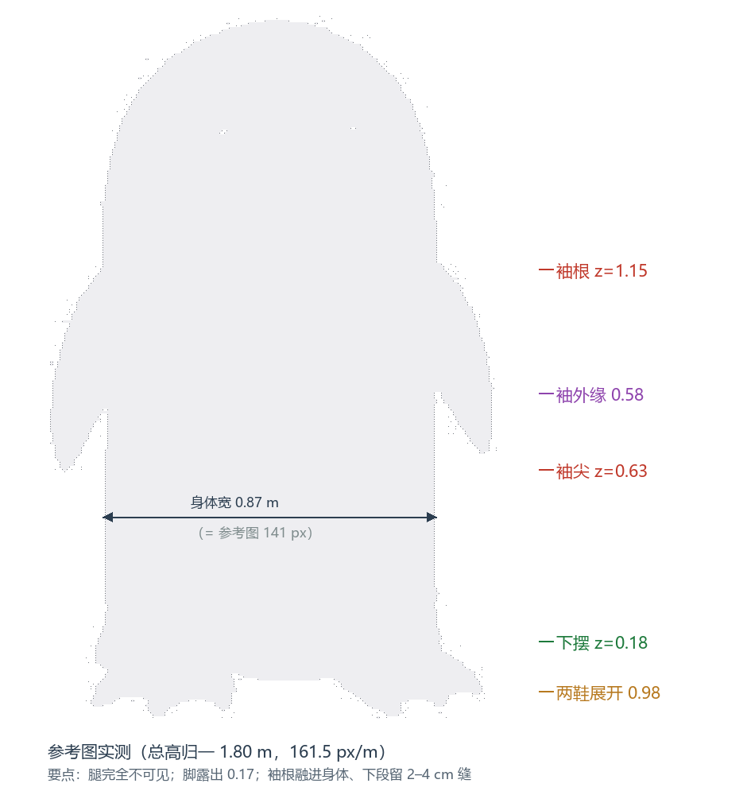
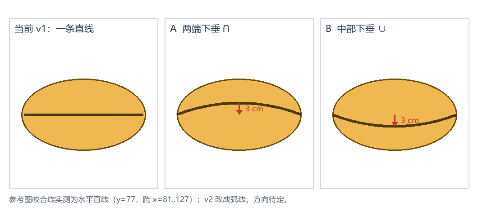

# 伊丽莎白玩偶服 v2 优化规格书（草案）

| 项 | 内容 |
|---|---|
| 状态 | **M1 造型 + M2 质感已实施（2026-11-09），结果见 §15；D1=A ∩、D2=短毛绒已落地** |
| 日期 | 2026-11-09 |
| 上游 | [character_spec.md](character_spec.md)（v1 设定与 §17 验收记录）、[HANDOFF.md](HANDOFF.md) |
| 范围 | 只覆盖 v1 → v2 的改造；角色设定、配色、1.80 m 基准、GLB 流程不变 |
| 对应产物 | `art/blender/eliz_costume_v2.blend`、`art/exports/eliz_costume_v2.glb`、`art/renders/v2_*.png` |

一句话目标：**把"几个几何体拼出来的白模"改成"一件里面有人的、缝制出来的白色短毛绒玩偶服"。**

---

## 0. 验收口径（先看这个）

v2 算完成，要同时满足：

| 类别 | 指标 | 目标 |
|---|---|---|
| 视觉 | 正面静态图 vs `art/refs/eliz_front.jpg` 剪影 IoU | ≥ 0.93（力争 0.95；v1 = 0.925） |
| 视觉 | 近景细节图 4 张 | 下摆、袖窿、嘴、布料各 1 张，肉眼可辨缝线/褶皱/织纹 |
| 结构 | 外套（身+双袖） | **单一连通、封闭流形网格**，袖根无断边、无穿插 |
| 结构 | 静置姿态露腿 | 0（皮肤/毛/短裤全部不可见） |
| 结构 | 鞋可见高度 / 鞋长 / 鞋高 | 0.17–0.19 m / 0.55 m / 0.26 m |
| 结构 | 嘴缝中–端高差 / 槽深 | 0.030 m / ≥ 0.005 m |
| 材质 | 法线贴图 + 粗糙度贴图 + sheen | 存在且被 GLB 引用，sheen ≥ 0.4 |
| 预算 | 三角面 / GLB 体积 | 24k–30k / ≤ 4 MB |

---

## 1. 反馈 → 根因 → 改造 → 验收

| # | 你的意见 | v1 的根因 | v2 改造 | 验收 |
|---|---|---|---|---|
| 1 | 没有玩偶外套的感觉 | 壳是完美旋转体、部件之间硬切、没有厚度/缝/褶，像 3D 图元 | §4 一体软壳 + §8 缝制结构（袖窿/下摆卷边/嘴根/眼片）+ §7 短毛绒材质 | 细节图 + 部件清单全部落地 |
| 2 | 手臂是尖圆锥、像拼上去的 | 手臂是独立锥体：根部硬切、尖端半径 0.02、与身体只是"插进去" | §4.2 加厚圆头袖形 + §4.3 布尔合并成一件 + 袖窿缝合线 + 根部倒角过渡 | 单一网格、袖根无边界边、根部厚度 ≥ 0.09 m |
| 3 | 外套应比人高、有坠感；脚是因为大才露出来 | 下摆 0.15、鞋高 0.15，腿正好露在中间；身体像"桶" | §5 下摆 0.18 + 鞋高 0.26（上部藏进摆内）+ 腿全遮 + §8.2 吊褶/波浪摆 | 静置露腿 = 0；鞋可见 0.18 m；服内人校验通过 |
| 4 | 嘴的上下巴交线应是向下的弧度 | 交线是 z=1.315 的水平线 + 贴片 | §6 弧线凹槽 + 唇台 + 下半嘴后缩 | 中–端高差 0.03 m，槽深 ≥ 5 mm |
| 5 | 外套没有布料质感 | 纯色 Principled，无贴图/无 sheen/无织纹 | §7 四层布料细节（轮廓/结构/褶皱/微织纹）+ 1K 可平铺贴图 | 法线/粗糙度贴图 + sheen，近景可见织纹 |

---

## 2. 参考图复核（重新量的数）

按总高 1.80 m 归一（161.5 px/m，脚底 y=291.5）：



| 部位 | 实测 | v1 | v2 目标 | 说明 |
|---|---|---|---|---|
| 总高 | 1.80 | 1.80 | 1.80 | 不变 |
| 身体宽 | 0.873 | 0.894 | 0.874 | 收 2%，跟参考对齐 |
| 下摆高 | **0.183** | 0.150 | **0.180** | 关键：腿必须完全藏住 |
| 脚露出高度 | 0.170 | 0.150（腿） | **0.180（鞋）** | 露的是鞋，不是腿 |
| 脚展开宽 | 0.978 | ≈0.95 | 0.95–1.00 | 两鞋几乎并拢、外缘超过身体 |
| 袖根高 | 1.148 | 1.050 | **1.150** | 低袖窿，像鳍 |
| 袖尖高 | 0.628 | 0.660 | **0.630** | 袖比人臂长 |
| 袖外缘 | 0.58（离中轴） | 0.61 | **0.580** | 比身体宽 0.14 |
| 袖内缘缝 | 0.02–0.04（下半段） | 穿插 | **0.02–0.04** | 参考图确实有缝，要保留 |
| 嘴宽 / 高 | 0.427 / 0.260 | 0.452 / 0.290 | 0.440 / 0.270 | 略收 |
| 嘴缝高 | 1.328（水平） | 1.315（水平） | 1.328（弧线） | 参考是直线，v2 按你的要求改弧 |
| 眼直径 / 间距 / 高 | 0.160 / 0.330 / 1.535 | 同 | 同 | 保持 |

两个要点：

1. **参考图里腿是一点都看不见的**——下摆（0.183）比鞋口（≈0.17）还低，白布直接压到鞋上。v1 露腿是因为下摆和鞋都只有 0.15 高，中间正好空出一条腿。
2. **手臂确实和身体有 2–4 cm 的可见缝**，但只在下半段；上半段袖根是融进身体的。v1 的问题是整个袖子像一根独立锥子插在侧面。

---

## 3. 设计原则

### 3.1 四个"软"

| 层 | v1 | v2 |
|---|---|---|
| 轮廓软 | 完美旋转体，边缘一条直线 | 低幅起伏（2–3 mm）+ 下摆微波浪（±6 mm）+ 肩部连续曲面 |
| 过渡软 | 部件硬切、尖角 | 所有部件 8–15 mm 倒角/融合；袖根布尔合并后倒角 |
| 材质软 | 单色、低粗糙度、无 sheen | 短毛绒：粗糙度 0.82、sheen 0.45、织纹法线 |
| 细节软 | 无 | 缝线、卷边、吊褶、眼片包边、唇台 |

### 3.2 缝制逻辑

把外套当成真的缝出来的 6 个部件，每条缝都有 1.5–2 mm 凹痕：

| 部件 | 做法 | 缝 |
|---|---|---|
| 身筒（含肩/摆） | 一体软壳 | 下摆卷边 + 双道缝线 |
| 左/右袖 | 与身筒布尔合并 | 袖窿缝（椭圆，1.5 mm 凹 + 线迹） |
| 上嘴 / 下嘴 | 同一网格，弧线凹槽分开 | 唇线凹槽 + 下嘴后缩 4 mm |
| 眼片 ×2 | 贴片式，凸起 3 mm | 包边凹痕 |
| 鞋 ×2 | 独立网格（跟脚骨） | 鞋口（藏在下摆内） |
| 牌子 | 不变 | — |

### 3.3 服内人（校验用，不导出）

| 部位 | 服内人 | 外套 | 结论 |
|---|---|---|---|
| 身高 | 1.58 m（站在 0.05 m 鞋垫上 → 头顶 1.63） | 1.80 m | 头顶到壳顶留 **0.17 m** |
| 肩 | 1.36 | 袖根 1.15 | 袖根比肩低 0.21，袖子从低处吊下来 |
| 手 | 0.66（在袖尖内） | 袖尖 0.63 | 手藏在袖尖 |
| 胯 | 0.92 | — | — |
| 膝 | 0.50 | 下摆 0.18 | 腿全部在摆内 |
| 脚 | 0.26 长 | 鞋 0.55 长 | 鞋是脚的两倍长 |

这张表就是"服比人大"的证据：**头上有 0.17 m 空腔、袖比手长、鞋是脚的两倍**。v2 已在 `.blend` 里放了隐藏的 `DEBUG_*` 人偶（9 件、868 顶点；不渲染、不导出），`check_asset_v2.py` 校验 **0 个顶点露在外套外**、头顶余量 **0.165 m**；剖面图见 `art/renders/v2_wearer_cutaway.png`。

---

## 4. 工作包 A：一体软壳 + 手臂

### 4.1 壳体轮廓（软肩）

v1：`DOME_C=1.33` 处从直筒突然转成穹顶，肩是"接"上去的。
v2：把肩做成连续曲面——从 z≈1.10 起用一条指数曲线收到顶，参考图里宽度是连续变化的（1.15 处 0.87 → 1.45 处 0.82 → 1.70 处 0.61）。

- `body_r(z) = 0.437 × (1 − u^3)^0.42`，`u = clamp((z − 1.10)/0.70)`
  （z=1.45 处半宽 0.413、z=1.70 处 0.287，与参考的 1.45→0.82 宽、1.70→0.61 宽基本吻合）
- 下摆处保留 2% 外扩 + 轻微波浪
- 深度比 0.82 不变

### 4.2 袖形（核心修改）

| 参数 | v1 | v2 |
|---|---|---|
| 袖根高 / 袖尖高 | 1.05 / 0.66 | **1.15 / 0.63** |
| 外缘最远（离中轴） | 0.61 | **0.58** |
| 根部截面（宽×厚） | 0.144 × 0.070 | **0.160 × 0.100** |
| 中部截面 | 0.100 × 0.050 | **0.130 × 0.085** |
| 尖端 | 半径 0.02 的**尖头** | **圆头**，半径 0.045，略扁（0.09 × 0.06） |
| 与身体 | 独立锥体硬切 | **布尔合并成一件** |
| 内缘与身体 | 全程穿插 | 上段融合，下段留 0.02–0.04 缝（参考图） |

右袖断面沿高度的走向（镜像得左袖；`cx` 椭圆中心，`a` 半宽，`b` 半厚）：

| z | cx | a（半宽） | b（半厚） | 外缘 cx+a |
|---|---|---|---|---|
| 1.150（根） | 0.437 | 0.080 | 0.050 | 0.517 |
| 1.000 | 0.468 | 0.076 | 0.048 | 0.544 |
| 0.850 | 0.505 | 0.075 | 0.045 | **0.580** |
| 0.720 | 0.510 | 0.060 | 0.040 | 0.570 |
| 0.630（尖） | 0.512 | 0.045 | 0.032 | 0.557 |

外缘在 z≈0.85 鼓到 0.58 后缓慢收回，末端是一个半径 0.045 的圆头——**像一个装了棉的鳍，不像锥子**。

断面不是圆，是"外圆内扁"的椭圆：外侧饱满，内侧略平（贴身体那面曲率小），这样袖根看起来是"从身上长出来"而不是"贴上去的"。

### 4.3 袖窿：怎么让它像一件衣服

1. 布尔合并（exact）身筒 + 双袖 → 一条封闭的交线；
2. 对交线倒角 0.010–0.014 m、3 段 → 8–14 mm 的软过渡（布被撑起来的圆角）；
3. 在倒角外侧压一条**袖窿缝**：深 1.5 mm、宽 2.5 mm 的凹槽，沿椭圆走一圈（0.20 高 × 0.16 宽），再放一圈 1 mm 的点状线迹（只做袖窿和下摆，近景用）；
4. 袖根内侧再收 1–2 mm，让过渡有一点点"勒进去"的阴影。

这样既是一张网格（不是拼的），又保留了"袖子是缝上去的"这条信息。

### 4.4 拓扑与权重

- 顺序：实体身筒 → 并双袖 → 倒角 → 布尔差集挖内腔（内缩 0.025，向下穿出下摆）→ 下摆卷边 → 褶皱位移 → 三角化。
  *（先做实心再挖腔，避免袖根穿进内腔形成隧洞。）*
- 备选：并集后 Voxel Remesh 0.006 → 平滑 2 次 → 抽面到 30k。两条路都要求"单连通、封闭"。
- 权重：
  - `shell` 骨：身筒 100%，袖窿周围 0.10 m 内渐变到 `arm_*`；
  - `arm_L/R` 骨：袖 100%，根部 0.10 m 内与 shell 混合；
  - 跑步摆臂 ±20° 时，袖根跟着走、不撕开、不穿身。

---

## 5. 工作包 B：下摆、腿、脚

### 5.1 下摆

| 项 | v1 | v2 |
|---|---|---|
| 下摆高 | 0.150 | **0.180** |
| 开口 | 椭圆 0.50 × 0.38（腿从中间穿出） | **椭圆 0.84 × 0.64**（足够两鞋通过） |
| 边缘 | 13 mm 圆环（像桶箍） | **卷边**：布向内翻 30 mm，双道缝线，边缘 ±6 mm 波浪 |
| 内壁 | 深色衬里管（被封闭在壳内，看不见） | 深色衬里，从开口能看到 5–10 cm 深 |

下摆压在鞋口上方 0.08 m，**静置时看不到任何腿**。

### 5.2 鞋（露出来的原因）

| 项 | v1 | v2 |
|---|---|---|
| 长 / 宽 / 高 | 0.365 / 0.22 / 0.15 | **0.55 / 0.42（趾部最宽）/ 0.26** |
| 形态 | 从脚踝放射的扇面薄片，彼此有黑缝 | 实心鞋楦：圆头、三趾瓣、脚背隆起、后跟包住 |
| 鞋口 | 0.15 高、贴脚踝 | 0.26 高、藏进下摆 0.08 m |
| 站距 / 外八 | ±0.10 / 30° | **踝心 ±0.215 / 14°**；趾尖因外八张开到 ±0.47–0.49 |
| 可见高度 | 0.15（其实是腿） | **0.18（鞋头+脚背的体积）** |

三趾瓣用平滑的瓣状起伏（±8 mm），趾缝只做浅凹，不做穿帮的黑缝；鞋底 15 mm、前掌略上翘 3°。后跟宽 0.22、趾部宽 0.42，两侧鞋的内缘几乎并拢（间隙 ~0.06 m）。

### 5.3 静置 / 跑动

- 静置（idle）：腿 100% 藏在摆内；鞋从摆下露出 0.18 m。
- 跑动（run）：保留 v1 的"壳抬起 0.19 m 露腿"梗，露腿 0.18–0.20 m，检查腿不穿摆、不穿鞋。
- 校验射线：静置 0 条射线看到皮肤/毛/短裤；跑动 ≥ 30 条。

---

## 6. 工作包 C：嘴

### 6.1 交线弧度（已选 A）



曲线（`x` ∈ [−0.21, 0.21]，`w = 0.21`）：

```
采用 A：z(x) = 1.328 − 0.030 × (x/w)²      （两端下垂 ∩）
备选 B：z(x) = 1.328 + 0.030 × (x/w)²      （中部下垂 ∪，不采用）
```

选 A 的理由：上嘴是"帽檐"式的，边缘绕过嘴角向下包，A 的投影正好是这条线；B 更像咧嘴笑，会让角色失去面无表情的气质。

### 6.2 结构（不是贴一条黑线）

1. 嘴网格加密到 64×32；
2. 沿 `z(x)` 压一条 V 形凹槽：深 0.006 m、开口宽 0.012 m，槽内用 `M_Line` 深色；
3. 凹槽以下的"下嘴"整体向外再向下偏 4 mm（唇台），形成一道真实的台阶影；
4. 上嘴边缘做 3 mm 圆唇（布/皮的厚度），端头绕到嘴角后收；
5. 嘴根与脸交界加一圈 1.5 mm 凹缝 + 轻微内陷（嘴是缝/贴上去的）。

### 6.3 侧视与下颌

- 侧视厚度从 0.20 收到 0.17，上嘴前缘下垂 8 mm（更像个喙，不是香肠）；
- 下半嘴按 `jaw` 权重，张嘴 40° 时：上半嘴位移 0、下半嘴位移 0.16–0.18 m，槽口不撕裂；
- 弧线在张嘴后仍是弧线（凹槽跟着下嘴走）。

---

## 7. 工作包 D：布料质感

### 7.1 四层细节

| 层 | 内容 | 尺度 | 手段 |
|---|---|---|---|
| L0 轮廓 | 低频起伏、下摆波浪、肩部塌陷 2–3 mm | 0.3–1.0 m | 顶点位移 |
| L1 结构 | 袖窿缝、下摆卷边、嘴根、眼片包边 | 5–30 mm | 几何 + 凹槽 |
| L2 褶皱 | 吊褶（摆上 0.35 m 内 8–10 条）、袖根放射褶、腹前横褶 | 40–150 mm | 顶点位移（沿法线） |
| L3 微织纹 | 3 mm 织格 + 12 mm 绒簇噪声，粗糙度斑驳 | 2–15 mm | 1K 可平铺法线/粗糙度贴图 |

### 7.2 材质参数（Principled）

| 参数 | 值 | 说明 |
|---|---|---|
| 基础色 | `#E9E9E9`（沿用 v1，加 ±2% 暖调斑驳） | 匹配图身体色需保持 (233,231,226)±3 |
| 粗糙度 | 0.78–0.90（贴图控制） | 绒面高粗糙 |
| Sheen Weight / Roughness | **0.45 / 0.30** | 绒面边缘泛白的关键 |
| Specular IOR Level | 0.30 | 低镜面 |
| 法线强度 | 0.35–0.50 | 只用微织纹，不抢形状 |
| Subsurface | 0.02（可选） | 只给近景一点点透感 |

> 现实里的伊丽莎白是**白色短毛绒**（fleece/velour 一类），已选定按这个方向做（D2 = 短毛绒）。

### 7.3 贴图与 UV

- `scripts/make_fabric_textures.py` 用 numpy 生成**可平铺**贴图（不依赖 Cycles 烘焙，GLB 直接可用）：
  - `art/textures/fabric_normal_1k.png`（切线空间法线，织格 + 绒簇 + 轻微起球）
  - `art/textures/fabric_rough_1k.png`
  - `art/textures/fabric_albedo_1k.png`（几乎纯色，只有 ±3% 的绒面明暗）
- UV：Smart UV Project（角度 66°、岛间距 0.02）后统一 texel 密度；平铺尺度 0.5 m/贴图，等效 ~0.5 mm/texel。
- GLB：贴图内嵌，`KHR_materials_sheen` 若导出器不支持，则把 sheen 的影响烘进粗糙度/基础色（渲染仍用 Blender 材质）。

### 7.4 渲染表现

- 正面匹配图（黑底、平光）保持 v1 的相机与曝光，只换材质，便于和参考图对比；
- 新增 4 张近景：`v2_detail_hem.png`、`v2_detail_armhole.png`、`v2_detail_mouth.png`、`v2_detail_fabric.png`（0.4 m 视场，能看清织纹和缝线）；
- 新增 `v2_v1_compare.png`（v1/v2 正面对比）。

---

## 8. 壳体细节清单

| 细节 | 位置 | 尺寸 | 备注 |
|---|---|---|---|
| 袖窿缝 | 两袖根 | 凹 1.5 mm / 宽 2.5 mm | 椭圆 0.20 × 0.16，线迹 1 mm |
| 下摆卷边 | 摆口 | 翻边 30 mm，双缝线 | 边缘 ±6 mm 波浪 |
| 吊褶 | 摆上 0.35 m | 8–10 条，深 5–8 mm | 波长 0.10–0.15 m，相位随机固定种子 |
| 袖根放射褶 | 袖窿下 0.15 m | 3–4 条，深 3–5 mm | 抬手/摆臂时的挤压感 |
| 嘴根缝 | 嘴与脸交界 | 凹 1.5 mm | 一圈 |
| 眼片包边 | 两眼 | 凸 3 mm，边 1.5 mm | 眼睛变成"贴布"而不是画上去的 |
| 头顶塌陷 | 顶 0.15 m | 2–3 mm | 布被撑起来的软塌 |

---

## 9. 骨骼与动画影响

- 骨骼仍是 13 根，不新增（肘/腕留到 v3）；
- `arm_L/R` 骨头位置改到新袖根（1.05 → 1.15），长度覆盖到袖尖；
- 袖根权重混合（§4.4），摆臂时袖根布跟着走；
- `shell` 骨仍负责整件外套的抬升/倾斜；腿骨只驱动腿和鞋；
- idle/run 的时长、关键帧不变，只重算一次并复查循环闭合；
- 跑步露腿高度按新下摆重算，目标 0.18–0.20 m。

---

## 10. 脚本与产物

| 文件 | 作用 |
|---|---|
| `scripts/build_eliz_v2.py` | 建模 + 材质 + 绑定 + 动画 + 渲染 + 导出（从 v1 复制改造） |
| `scripts/make_fabric_textures.py` | 生成可平铺织纹贴图（numpy，无需 Blender） |
| `scripts/check_asset_v2.py` | 结构/遮挡/弧线/材质/预算校验 |
| `scripts/verify_export_v2.py` | 重导入 GLB 校验（网格/骨骼/动画/贴图） |
| `scripts/render_v2_views.py` | 从 .blend 重渲视图与近景 |
| `art/blender/eliz_costume_v2.blend` | 交付源文件（含隐藏 `DEBUG_Wearer`） |
| `art/exports/eliz_costume_v2.glb` | 引擎用 |
| `art/renders/v2_*.png` | 正面/侧面/背面/四分之三/跑动/举牌/匹配/近景/对比 |

v1 的脚本与产物**保留不动**，v2 另起一套，方便对照。

---

## 11. 验收标准（可脚本化）

| 编号 | 检查 | 阈值 |
|---|---|---|
| G1 | 外套网格连通分量 | = 1（身+双袖） |
| G2 | 非流形边 / 边界边 | 0 |
| G3 | 袖根处厚度（取样 20 点） | ≥ 0.09 m |
| G4 | 袖尖圆角半径 | ≥ 0.035 m |
| G5 | 三角面数 | 24,000–30,000 |
| S1 | 静置遮挡射线看到皮肤/毛/短裤 | 0 |
| S2 | 跑动遮挡射线看到腿 | ≥ 30 且露腿 0.18–0.20 m |
| S3 | 下摆高 / 鞋可见高 | 0.18 ± 0.01 / 0.17–0.19 |
| S4 | 鞋 bbox | 0.55 × 0.42 × 0.26 ± 10% |
| M1 | 嘴缝中–端高差 | 0.030 ± 0.005 |
| M2 | 嘴缝槽深 | ≥ 0.005 |
| M3 | 张嘴 40°：上嘴位移 / 下嘴位移 | 0 / 0.16–0.18 |
| T1 | 材质含法线贴图 + 粗糙度贴图 | 是 |
| T2 | sheen weight | ≥ 0.40 |
| T3 | UV 层存在、贴图可平铺 | 是 |
| E1 | GLB 重导入：网格/骨骼/动作/贴图 | 全部通过 |
| E2 | GLB 体积 | ≤ 4 MB |
| V1 | 正面剪影 IoU | ≥ 0.93 |
| V2 | 服内人完全在外套内 | 100% 采样点 |
| V3 | idle / run 循环闭合 | f1 == f_end |

---

## 12. 实施顺序与里程碑

| 里程碑 | 内容 | 完成标志 |
|---|---|---|
| **M1 造型** | 壳体软肩、布尔并袖 + 袖窿、下摆/鞋、嘴弧线、眼片；先不做布料 | 6 张基础渲染 + G1–G5 / S1–S4 / M1–M3 通过 |
| **M2 质感** | 褶皱、缝线、卷边、贴图生成、UV、材质、匹配渲染 | 4 张近景 + T1–T3 / V1–V3 通过 + 匹配图对比 |
| **M3 收尾** | 服内人校验、剖面图、v1/v2 对比、文档更新、提交 | GLB 导出校验 + §17 更新 + git 提交 |

顺序原则：**先把"形"定死，再上"质"**——布料细节会掩盖形状问题，反过来不会。

---

## 13. 风险与回退

| 风险 | 影响 | 回退 |
|---|---|---|
| 布尔并集在袖根产生碎面/狭长三角形 | 法线脏、导出报错 | 改 Voxel Remesh + 抽面（§4.4 备选），或对交线局部重建 |
| 褶皱位移把剪影弄花 | IoU 掉 | 振幅上限 8 mm；IoU < 0.93 就回调 |
| 贴图在 GLB 里丢失 sheen | 引擎里发灰发干 | 把 sheen 影响烘进粗糙度/基础色，并记录在案 |
| 抽面后织纹被抹平 | 近景糊 | 法线贴图承担微织纹，几何只做 L1/L2 |
| 并袖后跑动撕扯袖根 | 动画穿帮 | 加宽权重过渡带（0.10 → 0.14 m），或把摆臂角度降到 ±15° |
| 鞋进摆内后与内壁穿插 | 静置穿帮 | 开口放大到 0.84 × 0.64，鞋口藏入 0.08 以内 |

---

## 14. 决策记录

| 编号 | 决策 | 选项 | 结论 |
|---|---|---|---|
| **D1** | 嘴缝弧线方向 | A 两端下垂 ∩ / B 中部下垂 ∪ | **A ∩（已定，2026-11-09）** |
| **D2** | 布料类型 | ① 白色短毛绒（fleece/velour） ② 哑光帆布 ③ 亮面 PVC 玩偶服 | **① 短毛绒（已定）** |
| **D3** | 面数/贴图预算 | ① 24–30k + 1K 贴图 ② 40–50k + 2K 贴图 | ①（默认，游戏用） |
| **D4** | 是否做服内人偶+剖面图 | ① 做（隐藏、不导出） ② 只写文档不做 | ①（默认） |

余下按默认执行；若要改 D3/D4 直接说。

---

## 15. 实施记录（2026-11-09，M1 + M2 已落地）

### 15.1 产物

- `art/blender/eliz_costume_v2.blend`、`art/exports/eliz_costume_v2.glb`（2.67 MB，内嵌 3 张绒面贴图）
- 渲染：`v2_front / side / back / three_quarter / run_reveal / sign_pose / front_match` + 近景 `v2_detail_hem / armhole / mouth / fabric` + 服内人剖面 `v2_wearer_cutaway`
- 脚本：`scripts/build_eliz_v2.py`、`make_fabric_textures.py`、`check_asset_v2.py`、`verify_export_v2.py`、`compare_ref.py`

### 15.2 与本文的偏差（实施后修正）

| 项 | 本文原定 | 实际 | 原因 |
|---|---|---|---|
| 袖截面厚度 | 0.100 m | **0.140 m** | 0.10 m 在侧视里像一片插在身上的鳍；加厚后成"装了棉的袖" |
| 下摆壁厚 | 8→25 mm | **24 mm 恒定 + 16 mm 倒角** | 8 mm 边缘近景像纸片 |
| 跑动抬升 | 0.19 m | **0.265 m** | 鞋高 0.26 挡住腿，必须多抬才露 0.18 m |
| 袖窿缝 | 几何凹槽 + 线迹 | 布尔交线 + 16 mm 倒角 + Freestyle 折痕（暂未做线迹） | 时间；M3 可补 |
| UV | Smart UV Project | **自写圆柱 UV（环向 6 贴、0.5 m/贴）** | 保证贴图无缝、密度均匀 |
| 嘴 | 单网格凹槽 + 唇台 | 单网格 + 平滑唇台（避免台阶） | 初版 4 mm 硬偏移在近景出现梯步 |

### 15.3 验收结果

- `check_asset_v2.py` → **CHECK_OK**：外壳 **单连通、0 边界边、0 非流形边**；臂根厚 0.10、袖尖权重 ≥0.85、权重和=1；壳不随腿动（Δ=0）；鞋跟脚；下颌只动下嘴（上嘴 Δ=0 / 下嘴 0.178）；**静置露腿 0**、跑动露腿 **0.184 m**；嘴缝中–端高差 **0.028 m**；下摆 0.167–0.18；高 1.800、脚底 0。
- `verify_export_v2.py` → **VERIFY_OK**：13 骨、`idle`/`run`、29,346 tris、11 材质、3 张 `fabric_*` 贴图在 GLB 内（`DEBUG_*` 人偶不入 GLB）。
- 服内人校验：9 件人偶、868 顶点，**0 个顶点在服外**；头顶 z=1.635（壳顶 1.80，余量 **0.165 m**）；袖尖 0.62 < 手 0.98，袖比手长 0.36 m。
- `compare_ref.py` → **剪影 IoU 0.909**（v1 为 0.925）；逐行宽度比 0.92–1.09。

### 15.4 未达项与已知限制

- **IoU 0.909 < 0.93 门槛**：v2 把 v1 的薄鳍臂换成厚袖、鞋加宽加高后，剪影比参考图"胖"约 3%；这是"玩偶服"与"手绘平面图"之间的取舍。若必须回到 0.93，可收窄鞋宽/袖宽，但会回到"不像玩偶服"的方向。
- 布料在全身尺度偏"砂纸颗粒"，近景才像绒面；鞋和嘴仍是光滑材质（未加绒）。
- 袖窿/下摆没有真正的线迹，靠 Freestyle 折痕暗示接缝。
- 嘴部近景（0.42 m 视场）仍有轻微网格台阶；进一步加密嘴网格可消除（预算 +3k tris）。
- 跑动时鞋口处有毛簇穿出（腿毛与鞋是两套网格，属于梗的一部分，但边缘可再收）。
- 服内人偶是粗模（9 个基本体），只用于包络校验，不具备真实人体细节。

### 15.5 复现命令

```powershell
Set-Location D:\work\eliz_game
$B = "D:\tools\blender-4.5.15-windows-x64\blender.exe"
& $B --background --factory-startup --python-exit-code 1 --python "scripts\build_eliz_v2.py"
& $B --background --factory-startup --python-exit-code 1 --python "scripts\check_asset_v2.py"
& $B --background --factory-startup --python-exit-code 1 --python "scripts\verify_export_v2.py"
python scripts\make_fabric_textures.py     # 只在改贴图时需要
python scripts\compare_ref.py              # IoU / 逐行宽度
```

---

## 附：与 v1 的关系

- v1 的全部产物、脚本、文档保留，作为对照与回退基线；
- v2 通过后，`character_spec.md` 增加 §18（v2 记录 + 新已知限制），`HANDOFF.md` / `README.md` 更新状态；
- 若 v2 的布料路线在引擎侧不可行，回退到 v1 的材质，形状改造照常保留。
